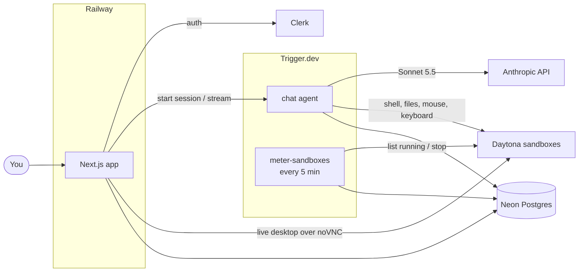

<div align="center">



# Crewmate

### The open-source alternative to Grok Bot, OpenAI Dots and Meta Muse

AI teammates with a job, a memory and a cloud computer of their own.

[](https://trigger.dev/)
[](https://www.daytona.io/)
[](https://www.firecrawl.dev/)
[](https://clerk.com/)
[](https://neon.com/)
[](https://railway.com/)

</div>

---

2026 is the year AI stopped being a chat box and became a coworker. Grok Bot, OpenAI Dots and Meta Muse all landed on the same idea: an always-on agent with a computer of its own that does the work instead of describing it. They are also closed.

Crewmate is an open exploration of that idea. Every prompt, tool and limit is a file in this repository, with auth, so you start from a working product and change whatever you like.

## ✨ Features

- 🧑‍💼 **Teammates with a job**: a name, a job and instructions that each bot keeps in every conversation.
- 🖥️ **A computer per teammate**: a persistent Linux sandbox with a shell, a filesystem and a graphical desktop.
- 👀 **Live desktop view**: watch a bot move the mouse and type, streamed into the chat.
- 👥 **Group chats with handoffs**: a bot passes a request to the teammate whose job it is.
- 🧠 **Memory across chats**: notes a bot saves in one conversation are there in all the others.
- ♾️ **Durable turns**: a long desktop task survives refreshes, redeploys and closed tabs.

### To be Done

- 🏢 **Live office view**: watch a bot move and act in an office environment, as it executes the tasks.
- 💳 **Plans and usage limits**: subscriptions, with model spend and sandbox hours metered per billing period.

## 🧱 Built with

| Product                                     | What it does here                                                                             |
| ------------------------------------------- | --------------------------------------------------------------------------------------------- |
| [**Trigger.dev**](https://trigger.dev/)     | Runs the durable chat agent and the cron task that meters running sandboxes.                  |
| [**Daytona**](https://www.daytona.io/)      | One cloud sandbox per bot: shell, files and a desktop it controls.                            |
| [**Clerk**](https://clerk.com/)             | Authentication.                           |
| [**Neon**](https://neon.com/)               | Serverless Postgres.                                                                          |
| [**Anthropic**](https://www.anthropic.com/) | Claude, the model the chat agent runs on, through the Anthropic API.                          |
| [**Railway**](https://railway.com/)         | Hosts the Next.js app in production.                                                          |
| [**Firecrawl**](https://www.firecrawl.dev/) | Web search and scraping for the coding agent this project is developed with, through its CLI. |

Plus Next.js 16, React 19, AI SDK 7, shadcn/ui, Tailwind CSS 4, Drizzle ORM and DiceBear.

## 🔍 How it works



- **A chat turn** (`trigger/chat.ts`) builds the bot's instructions from its job and streams a reply with the sandbox tools attached (`lib/sandbox-tools.ts`). It stops after 50 steps or when the allowance is spent.
- **In a group chat** the bot also gets a `handoff` tool, which gives the rest of the turn to a teammate. A request cannot bounce back to a bot that already held it.
- **Usage** is an append-only ledger. Model spend is written when a turn completes; sandbox time by a task that charges every running sandbox each five minutes and stops those of owners who have run out. Limits live in `lib/usage.ts`.

## 🚀 Getting started

You need Node.js 20.12+ and an account with [Clerk](https://clerk.com/), [Neon](https://neon.com/), [Trigger.dev](https://trigger.dev/) and [Daytona](https://www.daytona.io/).

**1. Clone and install**

```bash
git clone https://github.com/Borhan1997/Crewmate.git
cd Crewmate
npm install
```

**2. Create `.env.local`**

```bash
# Clerk: API keys
NEXT_PUBLIC_CLERK_PUBLISHABLE_KEY=
CLERK_SECRET_KEY=
NEXT_PUBLIC_CLERK_SIGN_IN_URL=/sign-in
NEXT_PUBLIC_CLERK_SIGN_UP_URL=/sign-up
NEXT_PUBLIC_CLERK_SIGN_IN_FALLBACK_REDIRECT_URL=/
NEXT_PUBLIC_CLERK_SIGN_UP_FALLBACK_REDIRECT_URL=/

# Neon: pooled string for the app, direct string for drizzle-kit
DATABASE_URL=
DATABASE_URL_UNPOOLED=

# Anthropic API Key
ANTHROPIC_API_KEY=

# Trigger.dev: the development key and the project ref
TRIGGER_SECRET_KEY=
TRIGGER_PROJECT_REF=

# Daytona
DAYTONA_API_KEY=
```

**3. Push the schema and run**

```bash
npm run db:push            # create the tables
npm run dev                # terminal 1: Next.js
npx trigger.dev@4.7.3 dev  # terminal 2: Trigger.dev tasks
```

Open [http://localhost:3000](http://localhost:3000), sign up, pick a plan and create your first teammate.

## 🚢 Deployment

The app runs on Railway and the tasks run on Trigger.dev, so there are two things to deploy.

**1. Deploy the app to [Railway](https://railway.com/)**

Fill in the variables it asks for. `TRIGGER_SECRET_KEY` is your Trigger.dev **production** key here, not the development one.

**2. Deploy the tasks to Trigger.dev**

```bash
npx trigger.dev@4.7.3 deploy
```

**3. Give the tasks their variables**

Add these to the project's production environment in Trigger.dev:

```bash
DATABASE_URL=
CLERK_SECRET_KEY=
DAYTONA_API_KEY=
ANTHROPIC_API_KEY=
```

## 🤝 Contributing

Issues and pull requests are welcome. Run `npm run lint`, `npm run typecheck` and `npm run format` before opening one.

---
